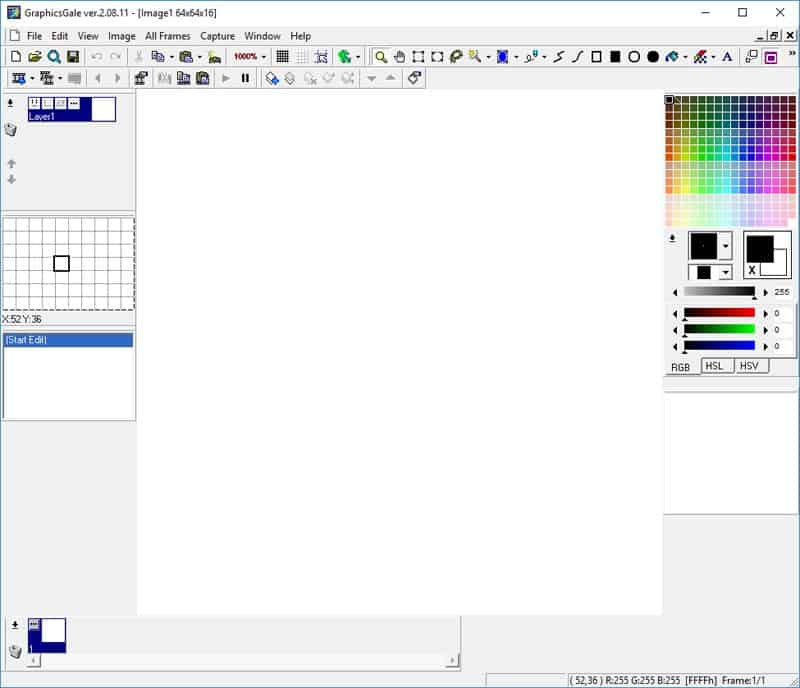
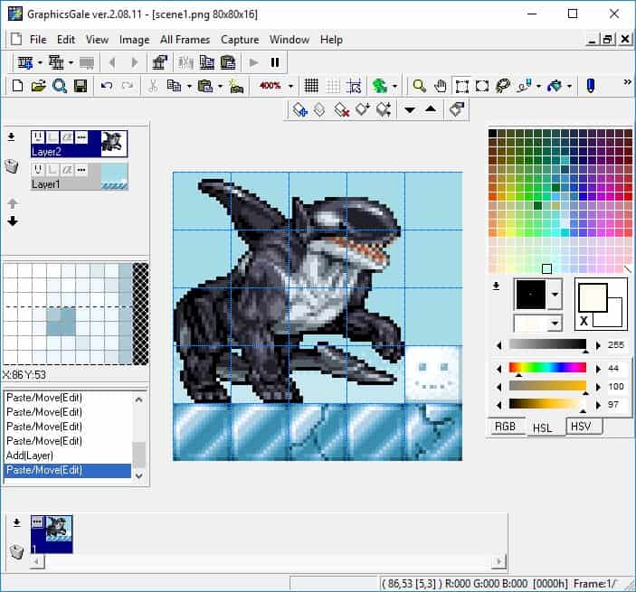

# GraphicsGale: Small Sprites with Clearly Defined Motion

A few pixels can carry a character's expression, a walking rhythm, or a readable game icon.
GraphicsGale combines pixel editing, layers, and animation previews in a Windows desktop editor.
Build a compact sprite, make its transparency intentional, and carry its frame order into the exported asset.

[](https://graphicsgale-animation.github.io/GraphicsGale/)

## Know which background you are removing

A checkerboard in the editor and transparency in an exported image answer different questions.
Check both before treating the asset as ready for another application.
Use a bright temporary background to reveal stray pixels around the silhouette.

GraphicsGale distinguishes transparent colors associated with layers and frames.
Its official FAQ explains that a layer's transparent color reveals the layers beneath it.
A frame's transparent color applies to an exported format that supports transparency.

| Transparency control | Scope | Where to check the result |
| --- | --- | --- |
| Layer transparent color | Visibility through a layer | Against another visible layer |
| Frame transparent color | Transparency for the exported frame | In the saved GIF or PNG |
| PNG alpha channel | Per-pixel alpha in a PNG export | Against contrasting backgrounds |

### Follow the documented export route

For transparent GIF or PNG output, the FAQ starts in File > Properties.
Enable Disable Transparency of Bottom Layer, open the frame properties, and enable Transparent Color.
Use the eyedropper to identify the intended transparent color, then save a copy in the chosen format.
The FAQ also describes PNG output with an alpha channel.

Keep a working copy before changing transparency settings.
A color used inside the character can disappear if you also select it as the transparent color.
Inspect every frame, including ones that contain only a small effect or a held pose.

### Erasing follows the transparency model

GraphicsGale's FAQ describes erasing by painting with the relevant background or transparent color.
The layer and frame settings determine how that color behaves.
If a pasted image behaves differently, check whether it carries an alpha channel before changing other settings.

Related Aseprite references distinguish color values, packed pixel data, and image specifications:
[color.lua](tests/scripts/color.lua), [app_pixel_color.lua](tests/scripts/app_pixel_color.lua), and [image_spec.lua](tests/scripts/image_spec.lua).
The conversion cases in [color_convert.lua](tests/scripts/color_convert.lua) include indexed-to-RGB background behavior.
Those distinctions are useful questions to bring to an export review.

## Animate the change the viewer should notice

Choose one motion before drawing a long sequence.
A blinking eye, a bouncing object, or a four-pose walk is enough to test a character's readability.
Keep the canvas dimensions and the character's reference position consistent.

GraphicsGale previews animation while you edit.
Its onion skin shows preceding and following frames through the current frame.
Use those references to compare positions, then judge the action in normal playback.



### Timing comes before extra detail

- Establish the strongest poses before adding intermediate drawings.
- Keep feet aligned with a common ground reference where appropriate.
- Look for unintended jumps in the head or torso.
- Compare the last frame with the first when making a loop.
- Use a deliberate hold when an expression needs time to register.

Equal frame counts do not guarantee equal perceived speed.
Spacing between positions and the time spent on each pose both affect the motion.
Watch the loop at its intended size so enlarged pixels do not distract from the action.

Aseprite's [frames.lua](tests/scripts/frames.lua) includes frame-number and duration checks.
Its [cels.lua](tests/scripts/cels.lua) and [cel.lua](tests/scripts/cel.lua) cover image content associated with layers and frames.
[sprite.lua](tests/scripts/sprite.lua) exercises sprite properties such as dimensions and color mode.

### Review a loop in two passes

First watch the silhouette without concentrating on texture.
Then inspect details such as highlights, eyes, and loose clothing.
A stable outline can still contain a distracting one-pixel flicker.

Keep a note of the intended frame order and duration.
When sharing a preview, include the actual exported animation so timing can be assessed outside the editor.
Retain the editable project for later corrections.

## Draw pixels that survive the final viewing size

Decide the sprite's working dimensions before polishing its outline.
A 32 by 32 character and a 64 by 64 character offer different room for facial detail.
Place a few major color clusters before spending time on isolated pixels.

GraphicsGale provides tools including Pen, connected lines, curves, shapes, and Color Replacer.
Use a simple tool when it gives better control over a short edge.
Review diagonal runs for accidental bumps and isolated marks.

### Enlarge a review copy without smoothing

For an exported PNG, ImageMagick 7 can create an eight-times-larger inspection copy.
Point filtering keeps the enlarged pixels sharply separated.
Choose an unused output filename.

```sh
magick "sprite.png" -filter point -resize 800% "sprite-review.png"
```

This changes the review image's dimensions, not the underlying drawing decisions.
Keep the original-size export beside it when judging readability.
Softened scaling can hide the exact placement of single pixels.

### Drawing and selection references

Aseprite's drawing checks provide examples of the concepts involved in pixel editing:

- [drawing.lua](tests/scripts/drawing.lua) includes clearing and pixel drawing cases.
- [pixel_perfect.lua](tests/scripts/pixel_perfect.lua) exercises pixel-perfect stroke behavior.
- [brush.lua](tests/scripts/brush.lua) checks brush properties.
- [paint_bucket.lua](tests/scripts/paint_bucket.lua) covers paint-bucket tool behavior.
- [selection.lua](tests/scripts/selection.lua) exercises selection objects.
- [selection_tools.lua](tests/scripts/selection_tools.lua) includes tool-level selection cases.

Use a small copied region to test a transformation before applying it to the entire character.
Confirm that moving a selection leaves the expected background behind.
Check the completed silhouette again after any rotation or size change.

## Give the exported sheet a predictable grid

GraphicsGale can export an animation as a sprite sheet, individual images, or a GIF.
Choose the form expected by the game engine, web page, or collaborator.
A sheet contains frame images; timing and animation names may need to be supplied separately.

For a simple handoff, use equal-size cells with a consistent origin.
Write down the cell width, cell height, number of frames, and reading order.
If you add spacing or borders, include those measurements in the handoff.



### A browser preview for one horizontal row

This CSS assumes a PNG named `walk-strip.png` measuring 256 by 32 pixels.
It contains eight 32 by 32 frames in one row, without padding or gaps.
Apply the class to an empty HTML element; the one-second cycle gives each frame equal time.

```css
.walk-preview {
  width: 32px;
  height: 32px;
  background: url("walk-strip.png") 0 0 no-repeat;
  animation: walk 1s steps(8, end) infinite;
}
@keyframes walk {
  to { background-position: -256px 0; }
}
```

The stepped timing selects discrete cells instead of sliding continuously across the sheet.
Change both the geometry and the animation distance when using another cell size or frame count.
This preview does not reproduce unequal per-frame durations automatically.

### References for checking the handoff

Aseprite's [import_sprite_sheet_command.lua](tests/scripts/import_sprite_sheet_command.lua) contains sheet-import test cases.
[compare_sprite_sheets.lua](tests/scripts/compare_sprite_sheets.lua) compares exported sheet data.
Its CLI checks cover sheet generation in [sheet.sh](tests/cli/sheet.sh) and numbered output in [save-as.sh](tests/cli/save-as.sh).

Reopen a representative export and confirm the frame count and order.
View the sheet against the destination's expected cell grid.
When exporting separate images, use names that preserve order under the recipient's sorting rules.

## Keep the palette consistent across the sequence

Reserve colors for visible roles such as outline, shadow, base color, and highlight.
Use the same role consistently across frames before adding extra shades.
Small palette changes can look like flicker when the animation plays.

GraphicsGale can reorder palette colors, remove unused entries, unite duplicates, and unify colors from multiple files.
Keep a revision before a palette-wide change.
Check transparency and every reused color afterward.

### Compare colors by what they do

Aseprite's [palette.lua](tests/scripts/palette.lua) checks palette entries and operations.
[color_quantization.lua](tests/scripts/color_quantization.lua) exercises color-reduction behavior.
The [gpl-palette-extension.md](docs/gpl-palette-extension.md) document describes Aseprite's alpha-aware GIMP Palette extension.

That extension is a format reference, rather than evidence that another editor accepts the same fields.
For a GraphicsGale tutorial, record the actual color values and palette operations used.
A reader can then reproduce the visual result without depending on an undocumented interchange path.

### Keep layer roles easy to recognize

Separate foreground details, the main body, and background references where that helps editing.
Hide temporary guides before making a delivery copy.
Check the preview after changing visibility or opacity.

Aseprite's [layers.lua](tests/scripts/layers.lua), [layer.lua](tests/scripts/layer.lua), and [layer_flags.lua](tests/scripts/layer_flags.lua) cover layer collections, properties, and flags.
Its [compose_groups.lua](tests/scripts/compose_groups.lua) concerns experimental group composition.
[z_order.lua](tests/scripts/z_order.lua) covers drawing-order cases.

## Preserve the editable sprite alongside the delivery copy

Save the GraphicsGale working document in GAL format before making flattened or animated exports.
Name revisions so the latest approved pose sequence can be identified without opening every file.
Keep the sheet dimensions and timing notes with the delivered assets.

The [official feature list](https://graphicsgale.com/us/spec.html) includes GAL, GIF, PNG, ICO, CUR, ANI, and other supported formats.
Use the [official FAQ](https://graphicsgale.com/us/faq.html) when resolving a GraphicsGale transparent background or GraphicsGale transparent color problem.
The [product page](https://graphicsgale.com/us/) identifies the editor as freeware and describes its export choices.

### Understand the supplied reference collection

The [ase-file-specs.md](docs/ase-file-specs.md) document specifies Aseprite's ASE/ASEPRITE format.
The sprite-fixture [README.md](tests/sprites/README.md) describes examples with layers, indexed colors, and animation tags.
The test-suite [README.md](tests/README.md) explains the collection's scope, while [file-formats.sh](tests/cli/file-formats.sh) exercises Aseprite format handling.

## Related Search Terms

GraphicsGale Animation, GraphicsGale, graphicsgale tutorial, graphicsgale transparent background, graphicsgale transparent color, pixel-art, animation, graphics, animated-sprites, spritesheet, gif, sprites, pixel-editor, sprite-editor, drawing
